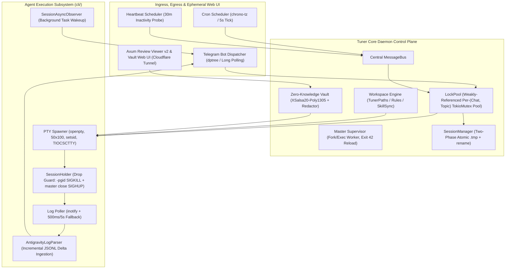

# Tuner System Architecture & Technical Specification

> **Canonical System Specification & Formal Invariant Model**  
> Baseline: `projects/tuner/src` | Target: Industrial Autonomous AI Agent Daemon

---

## 1. Executive Summary & Mental Model

### The Core Problem
Modern interactive LLM coding agent runtimes (such as the Google Antigravity CLI `agy`) are built strictly for single-user, synchronous POSIX teletype terminals. Exposing them directly to remote multi-channel daemon interfaces (Telegram, Cron, Telemetry) precipitates severe operating-system hazards:
1. **C Runtime Stdio Buffering Deadlocks (`_IOFBF`)**: Standard daemons lacking a PTY fall back to anonymous pipes, causing libc to buffer output in 4KB/8KB blocks, which halts real-time token streaming.
2. **Terminal Collapse via `isatty(3)` Failures**: TUI engines and rich progress spinners crash or panic on zero-dimension (`0x0`) headless pipes.
3. **Runaway Process Zombies**: Subprocesses and compiler jobs (`rustc`, `gcc`, `pytest`) spawned by the agent escape standard parent termination signals upon task aborts.
4. **State Corruption & Concurrency Races**: Uncoordinated multi-turn inputs across group topics and autonomous schedulers corrupt on-disk session state.

### The System Mental Model
**Tuner** functions as an **Industrial-Grade Asynchronous Agent Gateway & Virtual TTY Multiplexer**. It bridges remote human and external communication transports to agent execution runtimes by virtualizing a POSIX pseudo-terminal (PTY) environment with non-blocking master I/O, strict echo suppression, transcript-driven turn-state synchronization, and kernel-level process group lifecycle enforcement.



---

## 2. Complete Topographical Census (`src/`)

The Tuner daemon codebase is structured across 14 top-level modules enforced by `build.rs` and `build_linter.rs` (`AGENT_NATIVE.md`):

```text
src/
├── main.rs                   # Entry point: Supervisor mode vs Worker mode (--worker <profile>) & --vault CLI
├── config.rs                 # Schema definitions, profile merging & placeholder sanitization
├── setup.rs                  # Setup wizard, .env parser, systemd unit file generator (OOMPolicy=continue)
├── supervisor.rs             # Process monitor: fast-crash exponential backoff & hot restarts
├── upgrade.rs                # GitHub semver check, atomic .tar.gz unpack, zero-downtime rename
│
├── bus/                      # Cross-plane event fabric
│   ├── mod.rs                # Module index & public re-exports
│   ├── bus.rs                # MessageBus & Transport trait
│   ├── envelope.rs           # Canonical Envelope: Origin variants, DeliveryMode, LockMode
│   ├── lock_pool.rs          # Weakly-referenced per-(chat_id, topic_id) TokioMutex pool
│   └── adapters.rs           # Domain event transformers for cron and heartbeat outputs
│
├── workspace/                # Workspace governance, sandboxing & skill synchronizers
│   ├── mod.rs                # Module index & initialization orchestrator
│   ├── paths.rs              # TunerPaths: Canonical profile-isolated paths single-source-of-truth
│   ├── rules.rs              # RulesSelector: Prompt rule file seeding (AGENTS.md / constraints.md)
│   ├── sync.rs               # Folder initialization & non-destructive template synchronization
│   ├── sync_helpers.rs       # Whitelist file copy helpers & directory traversal
│   ├── sync_layout.rs        # Default workspace directory layout provisioning
│   ├── skills.rs             # YAML frontmatter discovery (---) & bidirectional skill sync
│   └── skills_helpers.rs     # Cross-platform symlinks and NTFS junctions
│
├── session/                  # State continuity, handover & disk serialization
│   ├── mod.rs                # Module index & local timezone daily reset / idle freshness checks
│   ├── manager.rs            # SessionManager: Two-phase atomic write (.tmp + rename), topic history
│   ├── data.rs               # SessionData, ProviderSessionData, past_session_ids & handover summaries
│   └── key.rs                # Immutable composite SessionKey (transport, chat_id, topic_id)
│
├── cli/                      # Agent substrate abstractions & CLI driver
│   ├── mod.rs                # AgentProvider trait, CliResponse, StreamEvent models
│   └── antigravity/          # Google Antigravity (agy) implementation
│       ├── mod.rs            # Driver index, AntigravityCli struct & path probing
│       ├── provider.rs       # Provider implementation, env configuration, oneshot & PTY runs
│       ├── pty_spawner.rs    # openpty (50x100), non-blocking AsyncFd, setsid, TIOCSCTTY, SessionHolder
│       ├── session.rs        # In-memory PTY child registry, AskState interactive question cache
│       ├── polling.rs        # notify inotify watcher + adaptive ticker monitoring transcript_full.jsonl
│       ├── completion.rs     # Step completion state machine & background task detection
│       ├── log_parser.rs     # Incremental JSONL parser generating TextDelta & AskQuestion
│       ├── log_helpers.rs    # Atomic line-boundary reading & JSON tool-call formatting
│       ├── events.rs         # Transcript JSONL schema deserializers
│       ├── error_parser.rs   # CLI exit codes & stderr failure diagnostic mapping
│       └── trust.rs          # Auto-trust workspace injection into ~/.gemini/antigravity-cli/
│
├── messenger/                # Messaging frontend adapters
│   ├── mod.rs                # Messenger module index
│   └── telegram/             # Telegram Bot integration, Web Review Viewer & TUI bridge
│       ├── mod.rs            # Subsystem index & turn orchestration
│       ├── auth.rs           # User/group authorization & first-user owner auto-registration
│       ├── runner.rs         # Teloxide bot initialization, scheduler wiring, restart watcher
│       ├── handler.rs        # Ingress message dispatcher, owner auto-registration, forum routing
│       ├── stream.rs         # Real-time streaming consumer, 2.0s edit debouncing, HTML chunker
│       ├── async_observer.rs # Background async command completion observer & automatic push
│       ├── handover.rs       # Topic session reset (/new) summary extraction & context injection
│       ├── handover_helpers.rs # Transcript tailing & handover prompt formatting
│       ├── attachments.rs    # Outbound native file:// link & image embed extraction
│       ├── attachments_dl.rs # Inbound Telegram media/document download to telegram_files/
│       ├── reply.rs          # Quoted prompt synthesis (> ), @model / --effort directive parser
│       ├── ask_process.rs    # Interactive ask_question inline keyboard loop
│       ├── ask_callbacks.rs  # Callback query dispatch for ask_question selections
│       ├── ask_helpers.rs    # Question state persistence & multi-select formatting
│       ├── multi_select.rs   # Interactive multi-option toggle state machine
│       ├── review.rs         # File review bundle builder & inline button generator
│       ├── review_server.rs  # Ephemeral Axum HTTP server + Cloudflare tunnel for Review Viewer v2
│       ├── review_store.rs   # Token-indexed file bundle store & ZIP archive entry inspector
│       ├── review_callback.rs # Callback handler launching Review Viewer v2 tunnel on demand
│       ├── review_viewer.html # Responsive dual-UX Web File, Code, Markdown, PDF, ZIP & 3D STEP Viewer
│       ├── vault.rs          # /vault command handler & HTTP CRUD endpoints (/vault/<token>/api/entries)
│       ├── vault_viewer.html # Responsive Web UI for per-profile credential management
│       ├── commands.rs       # Primary slash command router (/help, /status, /memory, /cron, etc.)
│       ├── commands_model.rs # /model & /effort interactive inline selector handlers
│       ├── commands_session.rs # /new, /reset, /stop & /abort session control handlers
│       ├── commands_usage.rs # /usage live quota parser, cache & progress bar formatter
│       ├── commands_remote.rs # /remote dashboard & Cloudflare tunnel lifecycle controller
│       ├── commands_remote_hub.rs # Local web terminal & remote service hub spawner
│       ├── commands_registry.rs # BotCommand registration & lock-free command classification
│       ├── callbacks.rs      # Model, language, cron & remote inline callback router
│       ├── callbacks_effort.rs # Effort level callback handler
│       ├── cron_selector.rs  # Paginated /cron interactive task inspector
│       ├── cron_formatter.rs # Cron schedule & execution status HTML formatter
│       ├── history.rs        # Topic name cache & message history helpers
│       ├── lang.rs           # /lang inline keyboard & per-session locale switcher
│       ├── media.rs          # Inbound media metadata & pending_attachments queue
│       ├── media_group.rs    # Telegram album (media_group_id) aggregation buffer
│       ├── rate_limiter.rs   # Per-chat token-bucket rate limiter avoiding HTTP 429
│       ├── session_init.rs   # Lazy PTY session initialization & handover preamble injection
│       ├── transport.rs      # TelegramTransport implementing bus Transport trait
│       ├── typing.rs         # TelegramTypingGuard (4s ChatAction::Typing + ⏳ reaction)
│       ├── upgrade.rs        # /upgrade interactive release check & binary swap trigger
│       └── formatting/       # Sentinel-based Markdown to Telegram HTML converter & tag balancer
│           ├── mod.rs        # Formatting pipeline entry point
│           ├── helpers.rs    # Markdown inline/block parser & expandable blockquote builder
│           ├── splitting.rs  # Tag-balanced 4000-char HTML message splitter
│           └── table.rs      # Box-drawing ASCII table renderer for Telegram <pre> blocks
│
├── cron/                     # Autonomous cron engine
│   ├── mod.rs                # Cron models & schedule definitions
│   ├── manager.rs            # CronManager: Job CRUD operations, run history, atomic storage
│   └── scheduler.rs          # CronScheduler: 5-to-6 field parsing, chrono_tz, quiet-hours skip
│
├── heartbeat/                # Autonomous telemetry & health monitoring
│   ├── mod.rs                # Heartbeat configuration & midnight-crossing quiet hours math
│   └── scheduler.rs          # HeartbeatScheduler: is_chat_busy, is_cooling_down, HEARTBEAT_OK silence
│
├── cleanup/                  # Storage maintenance & purger
│   ├── mod.rs                # Cleanup configuration
│   └── observer.rs           # Daily 3:00 AM sweep: retention pruning (preserving RULES.md/AGENTS.md)
│
├── security/                 # Ingress, filesystem & Zero-Knowledge Vault defense-in-depth
│   ├── mod.rs                # Security module index & path/vault re-exports
│   ├── paths.rs              # Path traversal protection: canonical root containment checks
│   ├── vault.rs              # Per-profile XSalsa20-Poly1305 encrypted credential store (vault/vault.enc & vault/vault.key)
│   └── vault_cli.rs          # tuner --vault (list|session|exec) CLI & stdout/stderr secret redactor
│
└── i18n/                     # Thread-safe multi-language localization
    ├── mod.rs                # Context hierarchy: TASK_ACTIVE_LANG -> GLOBAL_ACTIVE_LANG -> "en"
    ├── loader.rs             # TOML catalog loader & dot-notation flattener
    └── locales/              # 9 language catalogs (de, en, es, fr, id, ko, nl, pt, ru)
```

---

## 3. The Shadow Planes

### 3.1 Workspace & Sandbox Provisioning
* **Strict Profile Partitioning (`TunerPaths`)**: Every profile (`--profile <name>`) operates within an independent root `~/.tuner/profiles/<profile>/` with isolated configuration, memory, sessions, encrypted vault (`vault/vault.enc` & `vault/vault.key`), cron tasks, and workspace trees.
* **Tier-0 Native Rules Architecture**:
  - `AGENTS.md`: Framework constitution automatically updated during `/upgrade`.
  - `.agents/rules/constraints.md`: User-defined operational constraints (`trigger: always_on`), strictly preserved across upgrades.
  - `.agents/rules/mainmemory.md`: Durable factual archive synchronized from `memory_system/MAINMEMORY.md`.
* **Retention-Safe Cleanup (`CleanupObserver`)**: Automated retention sweeps inside `telegram_files/` and `output_to_user/` explicitly preserve `RULES.md` and `AGENTS.md` documentation files while reclaiming expired media artifacts.

### 3.2 Bidirectional Skill Synchronization (`SkillSyncer`)
* **YAML Frontmatter Enforcement**: Skills inside `<workspace>/skills/` are scanned; only directories containing a valid `SKILL.md` with opening/closing `---` frontmatter, `name:`, and `description:` are mounted.
* **Antigravity Native Discovery**: `SkillSyncer` bidirectionally synchronizes `<workspace>/skills/` and `<workspace>/.agents/skills/` so custom skills are natively discovered by the `agy` runtime without cross-profile contamination.
* **Substrate-Aware Link Builder**:
  - *Unix Host*: Standard POSIX symlinks.
  - *Windows Host*: NTFS directory junctions (`mklink /J`).

### 3.3 Cryptographic Bastions & Zero-Knowledge Credential Vault
* **Per-Profile Encrypted Credential Vault (`src/security/vault.rs`)**:
  - Encryption: 256-bit symmetric key (`vault/vault.key`, `chmod 0600`) encrypting `vault/vault.enc` via `XSalsa20-Poly1305` (`crypto_box::SalsaBox` with fresh 24-byte `OsRng` nonces).
  - Zero-Knowledge Execution (`tuner --vault exec <site> -- <cmd>`): Injects decrypted credentials (`TUNER_VAULT_SITE`, `TUNER_VAULT_TITLE`, `TUNER_VAULT_URL`, `TUNER_VAULT_USER`, `TUNER_VAULT_PASS`) directly into the child process environment while scrubbing all secret values from `stdout` and `stderr` (`***REDACTED***`), preventing credentials from leaking into the LLM transcript.
* **Path Traversal Sandboxing (`src/security/paths.rs`)**:
  - All outbound file attachments and web review viewer entries are canonicalized and verified against allowed workspace roots, preventing arbitrary host file exfiltration.

### 3.4 Context-Aware Dynamic Localization (`i18n`)
Language resolution traverses a 3-tier task-local fallback hierarchy:
$$\text{TASK\_ACTIVE\_LANG (tokio task-local)} \longrightarrow \text{GLOBAL\_ACTIVE\_LANG (RwLock)} \longrightarrow \text{"en"}$$
By scoping `TASK_ACTIVE_LANG.scope(lang, ...)` around the root `Future` prior to dispatching via `tokio::spawn`, the user's active locale travels seamlessly across multi-threaded Tokio work-stealing executor migrations.

---

## 4. Concurrency Model & Lifecycle Topography

### 4.1 Turn Genesis & Shared Weak LockPool Synchronization
To resolve concurrency contention in multi-topic environments (such as Telegram Forum Supergroups) without throughput collapse or split-brain state races, `SessionManager` and `MessageBus` share a single `Arc<LockPool>` keyed by `LockKey = (chat_id, Option<topic_id>)`:

```text
                       [ Shared LockPool: HashMap<(chat_id, Option<topic_id>), Weak<TokioMutex<()>>> ]
                                                             │
       ┌───────────────────────────────┬─────────────────────┴─────────────────────┬───────────────────────────────┐
       ▼                               ▼                                           ▼                               ▼
[ (Chat, Some(101)) Mutex ]     [ (Chat, Some(102)) Mutex ]                 [ (Chat, Some(103)) Mutex ]     [ (Chat, None) General Mutex ]
(Topic 101 Turn Executes)       (Topic 102 Turn Executes)                   (Topic 103 Turn Executes)       (General / Default Turn)
```

1. **Independent Topic Turns ($O(1)$ Parallelism)**:
   When an interactive message or scheduled bus envelope targets `(chat_id, Some(topic_id))`:
   - Retrieves or creates `Arc<TokioMutex<()>>` for `(chat_id, Some(topic_id))` from the shared `LockPool`.
   - Multiple topics within the same supergroup execute concurrently with zero cross-topic lock contention.
2. **Unified Bus & Interactive Serialization**:
   Because `MessageBus::with_lock_pool(sess.lock_pool.clone())` shares the exact same `LockPool` instance as `SessionManager`:
   - Autonomous `LockMode::Required` bus deliveries (Cron, Heartbeat) and interactive user turns targeting the same `(chat_id, topic_id)` serialize deterministically on the same `TokioMutex`.
   - Once all strong `Arc` guards for an idle topic are dropped, `LockPool::get` automatically prunes dead `Weak` entries (`strong_count() == 0`).

### 4.2 Zero-Queue Handle Decoupling for PTY Writes
To prevent map mutex contention during terminal input pacing:
1. `SessionManager::write_to_session` acquires the global `holders` map mutex for **$< 2$ microseconds** purely to extract `master_fd` and refresh `last_active`.
2. The map lock is immediately released before performing blocking/paced descriptor writes via `write_fd(master_fd, ...)`.
3. When `/stop` or `/abort` is received, soft `ESC` (`\x1b`) or session termination (`SessionHolder::drop` closing `master_fd` and sending `-pgid SIGKILL`) executes immediately without waiting on the `holders` lock.

### 4.3 Autonomous Background Schedulers & Observers
```
+──────────────────────+────────────────────────+──────────────────────+─────────────────────────+
| Subsystem            | Trigger Cadence        | Collision Guard      | Output Routing          |
+──────────────────────+────────────────────────+──────────────────────+─────────────────────────+
| CronScheduler        | Ticks every 5s         | Quiet Hours Skip     | MessageBus Envelope     |
|                      | (chrono-tz validation) | (Path traversal safe)| (target chat & topic)   |
+──────────────────────+────────────────────────+──────────────────────+─────────────────────────+
| HeartbeatScheduler   | Default every 30m      | is_chat_busy() &     | Suppressed if           |
|                      |                        | is_cooling_down()    | HEARTBEAT_OK detected   |
+──────────────────────+────────────────────────+──────────────────────+─────────────────────────+
| SessionAsyncObserver | Continuous background  | Active turn guard    | Automatic Telegram push |
|                      | transcript tailing     | (idle session only)  | on async task wakeup    |
+──────────────────────+────────────────────────+──────────────────────+─────────────────────────+
| CleanupObserver      | Daily 3:00 AM          | Non-blocking async   | Prunes expired files;   |
|                      |                        | file walk            | preserves RULES/AGENTS  |
+──────────────────────+────────────────────────+──────────────────────+─────────────────────────+
```

---

## 5. The 5 Supreme Invariant Defenses

```
+─────────────────────────────────────────────────────────────────────────────────────────+
|                                SYSTEM INVARIANT MATRIX                                  |
|  Invariant I:   Deadlock Immunity via Single-Lock Discipline                            |
|  Invariant II:  Host Substrate Invariance & Opportunistic Pipe Degradation               |
|  Invariant III: Liveness Verification & The Silence Contract                            |
|  Invariant IV:  Stream Integrity, Tag Balancing & Process-Guarded Ingestion             |
|  Invariant V:   Deterministic Teardown & POSIX Storage Atomicity                        |
+─────────────────────────────────────────────────────────────────────────────────────────+
```

### Invariant I: Deadlock Immunity via Single-Lock Discipline
* **Mathematical Invariant**: Let $L = \{l_{(c, t)} \mid c \in \text{Chats}, t \in \text{Topics}\}$ be the set of chat locks. Every interactive turn $T_i$ requests at most one lock from the pool:
  $$|L(T_i)| \le 1$$
* **Proof**: Under Coffman's conditions for resource deadlock, circular wait requires $T_1$ holding $l_A$ while requesting $l_B$, and $T_2$ holding $l_B$ while requesting $l_A$. Because no turn ever requests a secondary lock while holding a primary lock, circular wait is mathematically impossible:
  $$\forall i, j: \quad P(\text{Circular Wait}) = 0 \implies P(\text{Deadlock}) = 0$$
* **Weak-Reference Auto-Pruning**: Locks are cached as `Weak<TokioMutex<()>>`. A synchronous `std::sync::Mutex` critical section encapsulates lookup, garbage collection (`retain`), allocation, and downgrade insertion, eliminating split-brain races and memory leaks.

### Invariant II: Host Substrate Invariance & Pipe Degradation
* **Substrate Capability Probe**: Pseudo-terminal allocation is treated as a capability query, not an axiom:
  ```text
  Check /dev/ptmx permissions & probe openpty
       ├── Success ──► Full Interactive PTY Engine (SessionHolder, 50x100, setsid, TIOCSCTTY)
       └── Failure ──► Piped Headless Fallback (run_oneshot via standard POSIX pipes)
  ```
* **Immunity to Libc Block Buffering (`_IOFBF`)**: Because streaming deltas are tailed directly from the disk transcript (`transcript_full.jsonl`) generated by the CLI agent, anonymous pipe buffering semantics have zero effect on real-time text delivery.
* **Supervisory Resilience**:
  - Exit code 42 triggers an immediate hot reload (`fast_crash_count = 0`), while unexpected non-zero worker crashes failing within `< 10s` apply exponential backoff ($\min(2^n, 30.0)\text{s}$ in `Supervisor::run`) to prevent tight crash loops.
  - `systemd` unit files include `OOMPolicy=continue` so child compiler/browser OOM kills never bring down the `tuner.service` supervisor.

### Invariant III: Liveness Verification & The Silence Contract
* **The Fallacy of Wall-Clock Guillotines**: A fixed timeout prematurely kills legitimate long-running tasks (e.g. 10-minute Rust compilations or containerized test suites).
* **The Sliding Inactivity Contract**:
  $$\Delta t_{\text{silence}} = t_{\text{now}} - t_{\text{last\_activity}}$$
  Liveness is maintained as long as $\Delta t_{\text{silence}} < 300\text{ seconds}$. Any incremental append to `transcript_full.jsonl` (reasoning token, tool call, or tool completion status) refreshes the liveness timer.
* **Process-Group Termination on Silence**: When true silence exceeds 300 seconds, Tuner aborts the hung session and `SessionHolder::drop` delivers `SIGKILL` to `-pgid` along with closing `master_fd`.

### Invariant IV: Stream Integrity, Tag Balancing & Line Horizons
* **Process-State Guarded Log Ingestion**: When parsing `transcript_full.jsonl`, the file read pointer advances **strictly to the last confirmed newline byte (`\n`)** while the child process is active:
  $$\text{valid\_bytes} = \max \{ i \mid \text{buffer}[i] == \text{'\textbackslash n'} \}$$
  $$\text{effective\_advance} = \text{start\_pos} + \text{valid\_bytes} + 1$$
  Trailing partial JSON fragments are buffered until the subsequent flush, preventing severed multi-byte UTF-8 sequences and dropped tool calls.
* **Persistent CoT & Tool Visibility During Streaming**:
  - Intermediate streaming updates render `💭 Thinking Process:` and `🛠️ Tool Calls:` inside collapsible Telegram HTML `<blockquote expandable>` blocks (debounced at 2.0s).
  - Generic tool completion events refresh the liveness timer without emitting overwriting `Tool Completions` text, keeping the active reasoning and tool invocation context visible on screen while the LLM computes the next step.
* **Atomic Telegram HTML Tokenizer**:
  - Final responses are formatted via `markdown_to_telegram_html` and split via `split_html_message` (4,000-character ceiling).
  - HTML entities (`&(?:[a-zA-Z]+|#\d+|#x[0-9a-fA-F]+);`) are treated as atomic tokens alongside opening and closing tags, preventing entity bisection and Telegram HTTP 400 rejections.
  - An explicit `open_tags` stack closes open tags at chunk tails and rehydrates them at chunk headers, ensuring every delivered message is a balanced DOM fragment.

### Invariant V: Deterministic Teardown & POSIX Storage Atomicity
* **Process Group Annihilation (`-pgid SIGKILL`)**: In child `pre_exec`, Tuner sets `setsid()` and controlling terminal leadership (`ioctl(0, TIOCSCTTY, 0)`). Upon drop, `SessionHolder` delivers `SIGKILL` to `-pgid` (`Pid::from_raw(-(pid as i32))`), terminating the entire child and compiler process tree.
* **TTY Hangup Cascade (`SIGHUP`)**: Closing `master_fd` prompts the Linux TTY driver (`drivers/tty/pty.c`) to synthesize a hardware hangup signal (`SIGHUP`) across the slave foreground group, terminating any detached grandchildren.
* **Same-Directory Inode Atomic Persistence**:
  In `SessionManager::save` and `CronManager::save`, temporary files are written as siblings in the identical profile folder (`path.with_extension("tmp")`).
  $$\text{Mount}(\text{path.tmp}) \equiv \text{Mount}(\text{path.json})$$
  POSIX `rename(2)` is guaranteed to execute as an atomic single-inode directory swap. Cross-device link failures (`EXDEV`) are structurally impossible.

---

## 6. Verification & Mathematical Invariants Summary

| Invariant | Mathematical / POSIX Guarantee | Enforcement Mechanism | Failure Mode Prevented |
| :--- | :--- | :--- | :--- |
| **Deadlock Freedom** | $P(\text{Deadlock}) = 0$ via $|L(T_i)| \le 1$ | Shared Weak `LockPool` (`TokioMutex`) | Circular wait across topics and background schedulers |
| **Process Reclamation** | $\forall p \in \text{Tree}(\text{PID}): \text{Terminated}$ | `setsid()` + `-pgid SIGKILL` + `close(master)` | Rogue compiler zombies and orphaned background processes |
| **Storage Atomicity** | $\text{Mount}(\text{src}) = \text{Mount}(\text{dst})$ | Sibling `.tmp` path + `rename(2)` | `EXDEV` failures and corrupted partial state files |
| **Liveness Contract** | $\Delta t_{\text{silence}} < 300\text{s}$ | Inotify sliding activity deadline | False timeouts killing long compilation tasks |
| **Stream Atomicity** | $\text{Bal}(\text{Chunk}_k) = \text{True}$ | Tokenizer tag stack + entity atomicity | Telegram HTTP 400 Bad Request entity errors |
| **Zero-Knowledge Vault** | $\text{Plaintext} \notin \text{Transcript}$ | `XSalsa20-Poly1305` + `tuner --vault exec` Redactor | Credential leakage into LLM prompts, logs, or chat history |
| **Path Sandboxing** | $\text{Canonical}(p) \subseteq \text{Roots}$ | `validate_file_path` canonical containment check | Directory traversal and unauthorized host file exfiltration |

---

*This specification serves as the formal architectural blueprint and compliance baseline for the Tuner daemon engine.*
