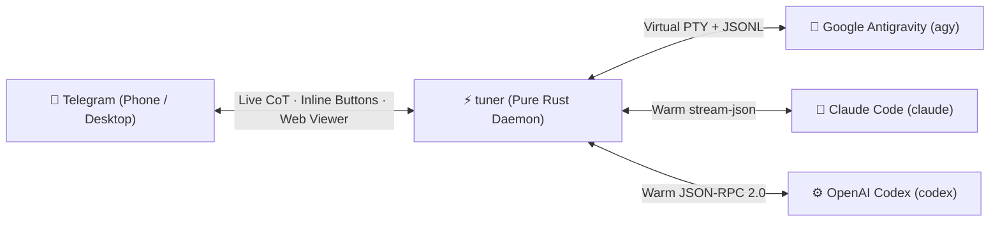

# ⚡ tuner

[](https://github.com/imwoo90/tuner/actions)
[](https://github.com/imwoo90/tuner/releases)
[](https://opensource.org/licenses/Apache-2.0)

**Put your local AI coding CLIs (`Antigravity` · `Claude Code` · `OpenAI Codex`) in your pocket via Telegram.**

`tuner` is a single-binary, pure-Rust agent orchestrator that turns your workstation or home server into a persistent 24/7 engineering studio accessible from your phone or desktop. Instead of paying extra per-token API bills on stateless cloud wrappers, `tuner` drives your **existing authenticated CLI subscriptions** directly against your local Git repositories, toolchains, and hardware.



---

## ✨ Why `tuner`?

- 🔄 **3 Engines, 1 Workspace (`/provider`)**
  Switch seamlessly between **Google Antigravity (`agy`)**, **Claude Code (`claude`)**, and **OpenAI Codex (`codex`)** per Telegram forum topic—or prefix a single message with `@opus`, `@sonnet`, `@astra`, `@sol`, or `@argon`. `tuner` automatically bridges your `AGENTS.md`, rules, and skills across all three CLIs.
- ⚡ **`0ms` Warm-Process Pool & Soft `/stop`**
  Every active topic keeps its own warm CLI process in memory (`0ms` cold-start from turn 2 onward, auto-reclaimed after 24h idle). Hitting `/stop` sends a soft turn interrupt (`ESC` / `control_request: interrupt` / `turn/interrupt`) without killing your warm session.
- 💭 **Real-Time Expandable Reasoning & Interactive Buttons**
  Watch `💭 Thinking Process` and `🛠️ Tool Calls` stream live inside collapsible Telegram `<blockquote expandable>` blocks. When an agent asks a multiple-choice question (`ask_question` / `AskUserQuestion` / `request_user_input`), answer it directly by tapping Telegram inline buttons.
- 🔍 **Mobile-Ready Web File & 3D Viewer (`/review`)**
  Whenever an agent references or generates files (`file://`), `tuner` attaches a one-tap **`🔍 Open File Viewer`** button backed by an ephemeral Cloudflare Quick Tunnel—supporting code diffs, Markdown, PDFs, image galleries, ZIP archives, and interactive **3D CAD (`.step` / `.stl` / `.glb`)** previews.
- 🔐 **Zero-Knowledge Credential Vault (`/vault`)**
  Store site logins per profile in an encrypted vault (`XSalsa20-Poly1305`). Agents run authenticated tools via `tuner --vault exec <site> -- <cmd>` while `tuner` automatically redacts secrets (`***REDACTED***`) from stdout/stderr so plaintext credentials never enter the LLM context.
- ⏰ **Autonomous Cron & Background Task Wakeup (`/cron`)**
  Schedule recurring agent workflows or let long-running builds/subagents finish asynchronously and wake the session automatically when done.

---

## 🚀 Quick Start (60 Seconds)

### 1. Install at least one supported Agent CLI
Authenticate any (or all) of the supported agent CLIs on your Linux machine:
- **Google Antigravity**: `agy` (verified with `v1.5.3`)
- **Anthropic Claude Code**: `claude` (verified with `v2.1.197`)
- **OpenAI Codex**: `codex` (verified with `v0.167.0`)

### 2. Install `tuner`
```bash
curl -fsSL https://raw.githubusercontent.com/imwoo90/tuner/main/install.sh | bash
```

### 3. Connect Telegram & Launch Service
1. Message [@BotFather](https://t.me/BotFather) on Telegram (`/newbot`) to get your **Bot Token**.
2. Message [@userinfobot](https://t.me/userinfobot) to get your numeric **Telegram User ID**.
3. Run the interactive setup wizard (configures your profile and registers the `systemd` daemon):
```bash
~/.tuner/bin/tuner --setup
```

> 💡 **Using Forum Topics (Recommended)**: Create a Telegram Group, enable **Topics**, invite your bot, and promote it to **Administrator** (`Manage Topics` + message reading). Each forum topic becomes an independent, persistent agent session!

---

## 🎮 Telegram Command Cheat Sheet

### Core Session & Engine Controls
| Command | What it does |
|---|---|
| `/provider` | Switch the current topic's CLI engine (`antigravity` · `claude` · `codex`) and update the `/` menu. |
| `/model` | Live-query the active CLI and switch models via inline buttons (or type `@opus`, `@sonnet`, `@astra`, `@argon`). |
| `/effort` | Adjust reasoning effort (`minimal` · `low` · `medium` · `high` · `xhigh` · `max`). |
| `/stop` | Soft-interrupt the current turn while keeping the warm CLI process alive. |
| `/new` \| `/reset` | Archive a handover summary of the current conversation and start a fresh session. |
| `/compact` | Compact conversation history to free up the context window. |
| `/status` · `/usage` | Inspect active provider/model/PID state, pending attachments, and remaining model quotas. |

### Workspace, Security & Remote Tools
| Command | What it does |
|---|---|
| `/vault` | Open the encrypted per-profile Credential Vault Web UI via an ephemeral Quick Tunnel. |
| `/remote` | Manage remote development access (`Antigravity` Web IDE tunnel, `Tailscale`, `SSH`). |
| `/cron` | Inspect, toggle, or immediately trigger scheduled background tasks (`⚡ Run Now`). |
| `/memory` · `/lang` | View durable workspace memory (`MAINMEMORY.md`) or switch session language. |
| `/upgrade` · `/restart` | Self-upgrade from [GitHub Releases](https://github.com/imwoo90/tuner/releases) or cleanly restart the daemon. |

### Native CLI Workflow Commands (Auto-switched per `/provider`)
| Active Provider | Available Workflow Slash Commands |
|---|---|
| **Antigravity (`agy`)** | `/plan` · `/grill_me` · `/goal` · `/teamwork` · `/boost` · `/learn` · `/browser` · `/schedule` |
| **Claude Code (`claude`)** | `/review` · `/security_review` · `/verify` · `/debug` · `/simplify` · `/deep_research` · `/code_review` · `/goal` · `/init` |
| **OpenAI Codex (`codex`)** | `/review` · `/init` |

---

## 🏛️ Architecture & Documentation

- 📖 **[ARCHITECTURE.md](ARCHITECTURE.md)** — Deep-dive specification covering the 2-Tier Master-Worker supervision tree, Virtual PTY + `transcript_full.jsonl` invariant polling, `ClaudeSessionPool` (`stream-json`), `CodexSessionPool` (`app-server --stdio` JSON-RPC 2.0), deadlock-free `LockPool`, and `XSalsa20-Poly1305` Shadow Plane security.
- 📦 **[GitHub Releases](https://github.com/imwoo90/tuner/releases)** — Full version history, CLI compatibility notes, and prebuilt Linux binaries.

<details>
<summary><b>🛠️ Local Development & Testing (Click to expand)</b></summary>

```bash
# Run compiler architecture linter, unit/integration tests, Clippy, and Rustdoc checks
cargo check
cargo test --all-targets
cargo clippy --all-targets -- -D warnings
RUSTDOCFLAGS="-D warnings" cargo doc --no-deps

# Deploy local changes to the isolated Docker sandbox (tuner-sandbox)
./scripts/dev_deploy.sh --restart
```
</details>

---

## 📄 License
Licensed under the [Apache License 2.0](LICENSE).
