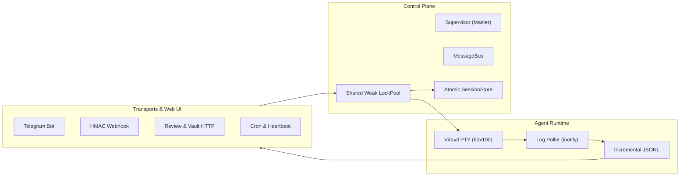

# tuner

[](https://github.com/imwoo90/tuner/actions)
[](https://opensource.org/licenses/Apache-2.0)

`tuner` supervises and orchestrates the execution of the Google Antigravity CLI (`agy`), providing real-time Telegram messenger integration, virtual PTY session management, expandable Chain-of-Thought & tool-call streaming, idle background turn wakeup, responsive web file/3D review viewing, per-profile Zero-Knowledge credential vaulting, webhook ingress, and multi-language localized agent sessions.

---

## 🚀 Quick Start Guide

### Step 1: Verify Antigravity CLI (`agy`)
Ensure the Antigravity CLI (`agy`) is installed and authenticated on your machine:
```bash
agy --version
```

### Step 2: Run One-Line Installer
Install the latest `tuner` release binary and required assets to `~/.tuner/bin/`:
```bash
curl -fsSL https://raw.githubusercontent.com/imwoo90/tuner/main/install.sh | bash
```

### Step 3: Run Interactive Setup & Service Registration
Launch the setup wizard to configure your Telegram bot token, allowed user IDs, and register the `systemd` daemon:
```bash
~/.tuner/bin/tuner --setup
```

---

## 📲 Telegram Bot Setup Guide

Connecting Tuner to Telegram takes 3 simple steps:

1. **Get Bot Token**:
   - Open Telegram and message [@BotFather](https://t.me/BotFather).
   - Create a bot (`/newbot`) and copy the **HTTP API Token**.
2. **Get Your Telegram User ID**:
   - Message [@userinfobot](https://t.me/userinfobot) to get your numerical Telegram User ID.
3. **Run Setup Wizard**:
   - Run `~/.tuner/bin/tuner --setup` and enter your Bot Token & User ID.

> 💡 **Group / Supergroup Setup**:
> If adding the bot to a group chat or forum topic thread, invite the bot and **promote it to Administrator** (enabling message reading) to bypass Telegram's default Privacy Mode.

<details>
<summary><b>⚙️ Manual Configuration Schema (`~/.tuner/profiles/default/config/config.json`)</b></summary>

```json
{
  "telegram_token": "YOUR_TELEGRAM_BOT_TOKEN",
  "allowed_user_ids": [123456789],
  "allowed_group_ids": [-100123456789],
  "provider": "antigravity",
  "model": "gemini-3.8-flash",
  "effort": "high",
  "language": "ko",
  "user_timezone": "Asia/Seoul"
}
```
</details>

---

## 🤖 Telegram Slash Commands

| Command | Description |
|---|---|
| `/help` | Show available bot commands and usage overview. |
| `/new` \| `/reset` | Archive current topic context (`last_handover_summary`) and start a fresh session. |
| `/status` | Generate bot health reports, `agy` CLI installation info, and active session model. |
| `/usage` | Query active model quotas, remaining percentages, and 5-hour/weekly refresh timers. |
| `/model` | Toggle the active LLM model for the current topic via an inline selector. |
| `/effort` | Select the reasoning effort level (`high`, `medium`, `low`) for the current LLM model. |
| `/lang` | Select the active session language (English, Korean, etc.) via an inline keyboard. |
| `/vault` | Launch the per-profile encrypted Credential Vault Web UI via Cloudflare Quick Tunnel. |
| `/remote` | Inspect and manage remote development services (Cloudflare Quick Tunnel, Web Hub) via an interactive dashboard. |
| `/cron` | Manage and inspect scheduled background cron tasks. |
| `/memory` | Output the current content of the workspace `mainmemory.md` / `MAINMEMORY.md` file. |
| `/upgrade` | Check GitHub Releases and perform an atomic in-place executable upgrade. |
| `/stop` | Gracefully cancel active agent CLI processes running in the current chat topic. |
| `/abort` | Forcefully terminate all running CLI sessions across topics. |
| `/restart` | Request a clean restart of the `tuner` bot daemon process. |
| `/plan` | Prompt the agent to generate a structured execution plan before running. |
| `/grill_me` | Launch an interactive interview to align requirements and refine plans. |
| `/goal` | Launch a long-running, thorough task until the goal is achieved. |
| `/learn` | Capture behavioral corrections or feedback and persist them to agent rules/memory. |
| `/compact` | Condense conversation history to free up the context window. |
| `/boost` | Launch deep reasoning and multi-perspective verification for complex tasks. |

---

## ✨ Key Capabilities

1. **Expandable Chain-of-Thought & Tool Streaming**:
   - Streams `💭 Thinking Process:` and `🛠️ Tool Calls:` in real time inside collapsible Telegram `<blockquote expandable>` blocks by tailing `transcript_full.jsonl` via `inotify`, keeping reasoning and active tool invocations visible until the next step arrives.
2. **Responsive Web File & 3D Review Viewer v2**:
   - Automatically extracts `file://` links and generated artifacts into a unified `🔍 Open File Viewer` button backed by an ephemeral Cloudflare Quick Tunnel, supporting desktop tree / mobile bottom-sheet navigation, 3D STEP/STL/GLTF rendering, multi-image gallery grids, ZIP archive inspection, row-synchronized syntax-highlighted code, Markdown, PDF, and inline `.html` `<iframe>` previews.
3. **Zero-Knowledge Per-Profile Credential Vault (`/vault` & `tuner --vault`)**:
   - Stores site credentials encrypted at rest (`XSalsa20-Poly1305`, `0600` permissions in `vault/vault.enc` and `vault/vault.key`) isolated per profile. Agents execute commands via `tuner --vault exec <site> -- <cmd>` with environment variable injection (`TUNER_VAULT_SITE`, `TUNER_VAULT_TITLE`, `TUNER_VAULT_URL`, `TUNER_VAULT_USER`, `TUNER_VAULT_PASS`) and automatic stdout/stderr secret redaction (`***REDACTED***`) so plaintext secrets never enter the LLM context.
4. **Autonomous Background Task Wakeup & Session Handover**:
   - Detects asynchronous background command completions (`spawn_session_async_observer`) and pushes follow-up agent responses directly to the originating Telegram topic. Preserves cross-session continuity across `/new` resets via structured handover summaries.

---

## 🤝 Development & Contribution Guide

To maintain stability between production environments and active development, we follow an isolated containerized workflow with separate Telegram bot tokens.

### 🏗️ Architecture Layout
- **Production Environment**: Runs official GitHub Releases on the Host PC/server (supervised via `systemd` with `OOMPolicy=continue` and `tuner` master daemon).
- **Development Environment**: Runs inside an isolated Docker container (`tuner-sandbox`) linked to a separate Telegram Dev Bot Token, sharing host `agy` authentication and state seamlessly.

### 🛠️ Setting Up Local Development

1. **Verify Host Prerequisites**:
   Ensure `agy` CLI is installed and authenticated on your host machine:
   ```bash
   agy --version
   ```

2. **Start the Sandbox Container**:
   Launch the development sandbox container via Docker Compose (automatically maps your user ID, `$HOME`, `agy` credentials, and `~/.tuner-dev` workspace):
   ```bash
   docker compose up -d
   ```

3. **Configure Development Bot Token**:
   Set your dedicated Telegram Dev Bot Token and allowed user ID in `~/.tuner-dev/profiles/default/config/config.json`:
   ```json
   {
     "telegram_token": "YOUR_DEV_TELEGRAM_BOT_TOKEN",
     "allowed_user_ids": [123456789],
     "language": "ko",
     "model": "gemini-3.8-flash",
     "effort": "high"
   }
   ```

### 🔄 Real-Time Build & Deploy Workflow
To test changes to source code (`src/`) or assets (`_home_defaults/`) in real-time:

```bash
# Run the automated dev deployment script
bash scripts/dev_deploy.sh
```

The `dev_deploy.sh` script automatically:
1. Compiles the latest release binary (`cargo build --release`).
2. Syncs the binary & `_home_defaults` asset folder to `tuner-sandbox`.
3. Auto-restarts the container worker daemon (`tuner --worker default`).

### 🚀 Maintainer Release Workflow
*(For repository maintainers only)*
To publish an official release:
1. Update version numbers in `Cargo.toml` and run `cargo check` to update `Cargo.lock`.
2. Commit with release notes: `git commit -m "chore(release): bump version to 0.1.x"`
3. Push `main` to both `main` and `release` branches:
   ```bash
   git push origin main && git push origin main:release
   ```
   GitHub Actions will automatically verify the build, generate tag `v0.1.x`, and publish binaries to GitHub Releases.

---

## 🏛️ System Architecture & Invariants

`tuner` is built as an **Industrial-Grade Asynchronous Agent Gateway & Virtual TTY Multiplexer**. It resolves the fundamental operating-system challenges of bridging interactive CLI agent binaries (`agy`) to asynchronous remote communication channels.



### 🛡️ Core Architectural Pillars & Invariants

1. **Virtual PTY Runtime (`openpty`, `50x100`, `setsid`, `ioctl(0, TIOCSCTTY, 0)`)**:
   - Eliminates C stdio block-buffering deadlocks (`_IOFBF`) and `isatty(3)` layout panics.
   - Sets child session and controlling terminal leadership (`setsid` + `TIOCSCTTY`) with `-pgid SIGKILL` and master-close `SIGHUP` cascade for zero-leak process reclamation.
2. **Shared Weak LockPool Synchronization (`LockPool`)**:
   - Forum topics execute concurrently with $O(1)$ parallelism via weakly-referenced per-`(chat_id, Option<topic_id>)` `TokioMutex` locks shared across `SessionManager` and `MessageBus`, pruning idle locks automatically once all strong guards drop.
   - Single-Lock Discipline guarantees provable mathematical deadlock freedom ($P(\text{Deadlock}) = 0$).
3. **Dual-Path Streaming & Invariant Polling**:
   - Streaming is decoupled from PTY stdout and tails on-disk structured logs (`transcript_full.jsonl`) via `inotify` + adaptive interval ticks.
   - Log cursor advances strictly to complete newline (`\n`) horizons, guaranteeing zero byte cleavage and zero dropped tool calls.
4. **Resilient Liveness Contract (Sliding Inactivity Window)**:
   - Replaces crude wall-clock timeouts with a 300s inactivity contract, honoring deep reasoning and long-running compilations without premature termination.
5. **Two-Phase Crash-Proof Persistence**:
   - Sibling temporary writes (`path.with_extension("tmp")`) + `rename(2)` guarantee atomic state persistence immune to cross-device `EXDEV` errors.

📖 **For the full architectural specification, mathematical proofs, shadow plane security, and second-order failure mode analyses, see [ARCHITECTURE.md](ARCHITECTURE.md).**

---

## 🧪 Testing

`tuner` enforces compiler-checked Agent-Native invariants and a comprehensive suite of 365+ Rust unit, integration, and documentation tests:

```bash
# Run compiler linter, unit/integration/doc tests, Clippy, and Rustdoc verification
cargo check
cargo test --all-targets
cargo clippy --all-targets -- -D warnings
RUSTDOCFLAGS="-D warnings" cargo doc --no-deps
```

---

## 📄 License
This project is licensed under the [Apache License 2.0](LICENSE).
